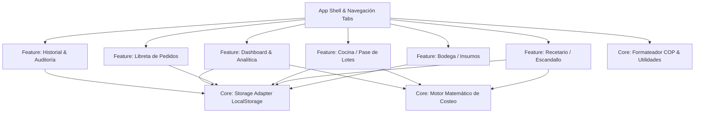

# 🏛️ Arquitectura del Sistema: GastroFlow

## 1. Visión General
**GastroFlow Artisan** es una plataforma para la gestión integral de talleres de cocina y repostería artesanal. Resuelve la complejidad del costeo real de materias primas, consumo energético, control de pedidos contra fecha de entrega prometida y el monitoreo de existencias de despensa.

El sistema fue diseñado bajo el principio **Offline-First**: no requiere conexión a internet para operar en cocina y almacena todo su estado localmente en el navegador, ofreciendo copias de seguridad portátiles en formato JSON.

---

## 2. Diagrama de Arquitectura Modular (Feature-Driven)

---

## 3. Principios de Diseño

1. **Vertical Slice / Feature-Driven**:
   El código no se divide por tipos genéricos de archivos sino por verticales de negocio (`src/features/`). Cada vertical contiene sus componentes, lógica interna y contratos.
2. **Determinismo Financiero**:
   Las funciones matemáticas de costos (`calculateRecipeCost`, `calculateBatchAvailability`, `calculateRealHourlyProfit`) son puras, libres de efectos secundarios y probadas exhaustivamente con Vitest.
3. **Persistencia Segura y Migración**:
   El adaptador de almacenamiento en `src/core/storage/` valida los esquemas al inicializar y proporciona valores por defecto seguros (`INITIAL_INSUMOS`, `INITIAL_RECETAS`, etc.) si el almacenamiento está vacío.
4. **Validación Automática en Navegador**:
   Cada interacción crítica (crear insumo, preparar tanda, cobrar pedido) es validada en navegadores Chromium mediante Playwright antes de que cualquier código toque la rama `main`.

---

## 4. Stack Tecnológico

| Capa | Tecnología | Justificación |
|---|---|---|
| Bundler & Servidor | **Vite** | Arranque instantáneo, Hot Module Replacement (HMR) ultrarrápido y compilación optimizada. |
| Librería UI | **React 18** | Renderizado declarativo basado en hooks (`useState`, `useMemo`, `useRef`). |
| Tipado | **TypeScript 5** | Tipado estricto para evitar errores en cálculos de gramajes, precios y unidades. |
| Estilizado | **Tailwind CSS 3** | Utilidades directas, consistencia visual con paleta cálida gastronómica (`brand-50` a `brand-950`). |
| Iconografía | **Lucide React** | Iconos SVG optimizados, accesibles y consistentes. |
| Unit Testing | **Vitest + RTL** | Pruebas unitarias de alta velocidad en entorno JSDOM compatible con Vite. |
| E2E Testing | **Playwright** | Ejecución de pruebas en navegador real para garantizar cero errores en producción. |
