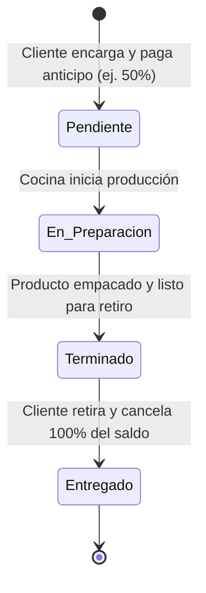

# 📅 Módulo 3: Libreta de Pedidos & Agenda Diaria

## 1. Propósito del Módulo
Administra la libreta de encargos de clientes con seguimiento de fechas límite de entrega, cronograma de horneo anticipado, control de cobros (anticipo del 50% y saldos pendientes) e integración con mensajes rápidos de WhatsApp.

---

## 2. Modelo de Datos (`Pedido`)

```typescript
export type EstadoPedido = 'pendiente' | 'en_preparacion' | 'terminado' | 'entregado';

export interface Pedido {
  id: string;
  cliente_nombre: string;
  cliente_telefono: string;
  receta_id: string;
  cantidad: number;
  fecha_entrega: string; // ISO YYYY-MM-DD
  hora_entrega: string;  // HH:MM
  notas: string;
  precio_total: number;
  abono: number;
  saldo_pendiente: number;
  estado: EstadoPedido;
  created_at: string;
}
```

---

## 3. Ciclo de Vida del Pedido



### Reglas de Negocio en la Entrega
- Cuando el pedido pasa al estado `entregado` y está completamente pagado (`saldo_pendiente === 0`), se contabiliza formalmente en las métricas del **Dashboard Financiero** (Facturación Bruta e Ingresos Netos).
- En caso de existir saldo pendiente al momento de la entrega, la aplicación alerta visualmente en color rojo con el botón de acción rápida `Cobrar Resto`.

---

## 4. Asistente y Agenda del Día
- Filtra automáticamente los pedidos programados para la fecha actual (`hoy`).
- Los organiza por hora de entrega prometida.
- La campana de notificaciones `🔔` alerta sobre entregas para **HOY** y para **MAÑANA** (para hornear con anticipación).

---

## 5. Encargos desde Tienda Online ("Los Brownies de Josefina")
- **Carrusel Etiquetado**: Vista interactiva con badges visibles en cada fotografía para identificar la presentación, forma (ej. Cuadrado, Corazón) o empaque (ej. Individual, Cajita de regalo).
- **Precio Dinámico en Vivo**: El valor unitario y total se recalculan en tiempo real al seleccionar variantes de tamaño, forma o presentación y al modificar la cantidad.
- **Compatibilidad con Supabase**: Las especificaciones seleccionadas se codifican de forma transparente en el campo `notas` (`[Variantes: ...]`) y `empaque_sugerido`, asegurando que la base de datos almacene los detalles exactos sin alterar el esquema relacional.
- **Confirmación y WhatsApp**: Al confirmar el encargo, la pantalla de éxito genera automáticamente el enlace a WhatsApp con el detalle completo de las opciones elegidas.
