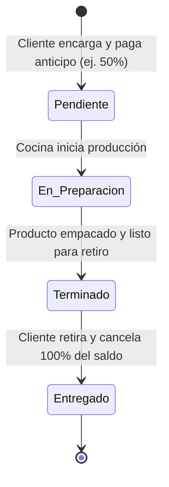

# 📅 Módulo 3: Libreta de Pedidos & Agenda Diaria

## 1. Propósito del Módulo
Administra la libreta de encargos de clientes con seguimiento de fechas límite de entrega, cronograma de horneo anticipado, control de cobros (anticipo del 50% y saldos pendientes) e integración con mensajes rápidos de WhatsApp.

---

## 2. Modelo de Datos (`Pedido`)

```typescript
export type EstadoPedido = 'pendiente' | 'en_preparacion' | 'terminado' | 'entregado';

export interface Pedido {
  id: string;
  cliente_nombre: string;
  cliente_telefono: string;
  receta_id: string;
  cantidad: number;
  fecha_entrega: string; // ISO YYYY-MM-DD
  hora_entrega: string;  // HH:MM
  notas: string;
  precio_total: number;
  abono: number;
  saldo_pendiente: number;
  estado: EstadoPedido;
  created_at: string;
}
```

---

## 3. Ciclo de Vida del Pedido



### Reglas de Negocio en la Entrega
- Cuando el pedido pasa al estado `entregado` y está completamente pagado (`saldo_pendiente === 0`), se contabiliza formalmente en las métricas del **Dashboard Financiero** (Facturación Bruta e Ingresos Netos).
- En caso de existir saldo pendiente al momento de la entrega, la aplicación alerta visualmente en color rojo con el botón de acción rápida `Cobrar Resto`.

---

## 4. Asistente y Agenda del Día
- Filtra automáticamente los pedidos programados para la fecha actual (`hoy`).
- Los organiza por hora de entrega prometida.
- La campana de notificaciones `🔔` alerta sobre entregas para **HOY** y para **MAÑANA** (para hornear con anticipación).

---

## 5. Encargos desde Tienda Online ("Los Brownies de Josefina")
- **Experiencia Móvil First en Cuadrícula Táctil (2 Columnas)**: Los productos en smartphones se organizan en `grid-cols-2` con fotografías cuadradas, badges claros y botones ergonómicos, evitando listas verticales infinitas.
- **Carrusel Etiquetado y Desacoplado**: Vista interactiva con badges visibles en cada fotografía para identificar la presentación o empaque. El modal permite personalizar y elegir entre `[+ Al Carrito]` (para seguir explorando) o `[Confirmar Encargo]` (checkout directo).
- **Carrito de Compras Multilínea (`ItemPedido[]`)**: Barra flotante inferior en celular con drawer de resumen, control de cantidades (+ / -), subtotales y detalle de variantes seleccionadas.
- **Reconocimiento Silencioso de Usuario**: El cliente diligencia sus datos de contacto y entrega una sola vez; en futuras compras la app lo reconoce con el saludo *"¡Hola de nuevo, [Nombre]! 👋"* y autocompleta automáticamente su perfil (`localStorage: gf_cliente_perfil`).
- **Métodos de Entrega**: Selector entre `🏪 Recoger en Taller` y `🛵 Envío a Domicilio` (con captura de dirección y barrio).
- **Tarjeta de Regalo**: Acordeón opcional para ingresar dedicatorias personalizadas (`[DEDICATORIA: ...]`), que se muestran de forma destacada en la tarjeta del pedido.
- **Disponibilidad Inteligente (Vitrina vs Bajo Encargo)**: Detección automática en el carrito si los productos están listos para entrega inmediata o si requieren horneo, ofreciendo entrega dividida (lo disponible hoy y el horneo mañana) o consolidada.
- **Transferencia Rápida con Copiado en 1 Clic**: Cuentas Nequi / Daviplata y Bancolombia integradas con botón de copiado rápido al portapapeles y confirmación por WhatsApp.
- **Compatibilidad con Supabase**: Los detalles de items múltiples, entrega y dedicatoria se serializan en el campo `notas` asegurando integridad total con la base de datos relacional.
