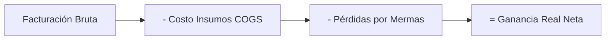

# 📊 Módulo 5: Dashboard Financiero, Analítica & Auditoría

## 1. Propósito del Módulo
Ofrece a la dueña del negocio una radiografía financiera transparente de su taller gastronómico: cuánto dinero ingresó efectivamente, cuánto se gastó en insumos y empaques (COGS), cuánto se perdió en mermas y cuál es la ganancia limpia en su bolsillo.

---

## 2. Indicadores Financieros Clave (KPIs)

1. **Facturación Bruta**: Suma del valor total de pedidos completados y pagados al 100%.
2. **Costo de Mercancía Vendida (COGS)**: Suma del costo de los ingredientes y empaques directos de las recetas entregadas.
3. **Pérdidas por Mermas**: Suma del valor monetario de todos los incidentes o accidentes registrados.
4. **Ganancia Real Neta**:
   $$\text{Ganancia Real Neta} = \text{Facturación Bruta} - \text{COGS} - \text{Pérdidas por Mermas}$$

---

## 3. Ránkings de Rendimiento

- **Producto Estrella (Top Rentabilidad por Hora)**:
  La receta que genera mayor retorno por hora de trabajo invertido de la cocinera.
- **Producto Más Vendido (Top Volumen)**:
  El producto con mayor cantidad de unidades despachadas en el periodo.

---

## 4. Historial & Auditoría
Proporciona trazabilidad completa con filtros de búsqueda:
- Registro cronológico de todos los pedidos finalizados.
- Bitácora de mermas con fecha, motivo y costo en COP.
- Historial de variación de precios de insumos por fecha.
- Herramientas de datos: Limpieza total ("Virgen") y Exportación de Respaldo JSON.
